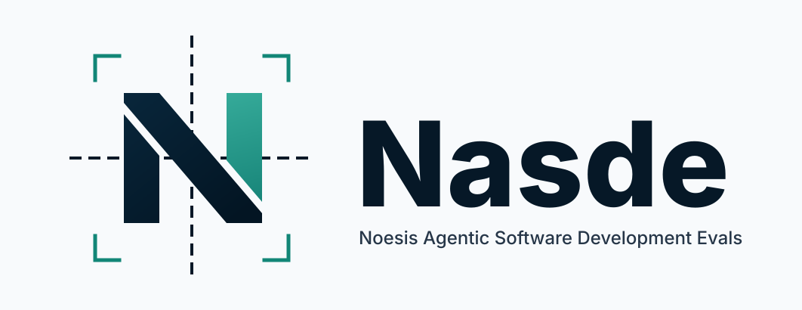
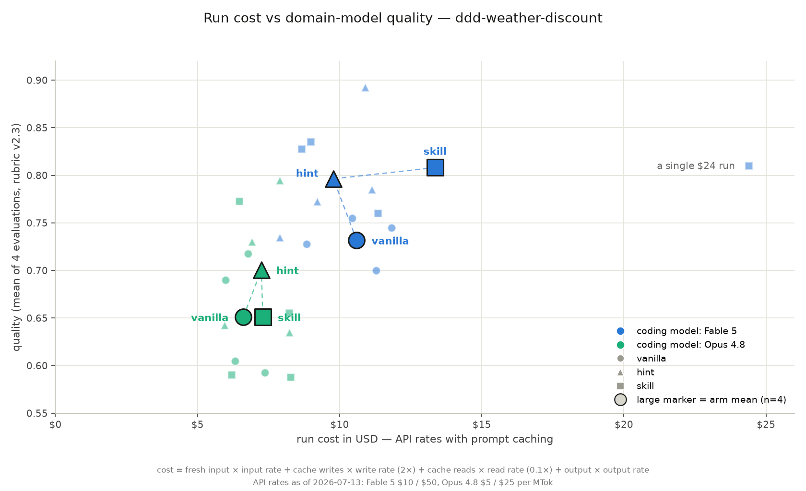

<div align="center">
  <a href="https://noesis.vision/nasde/"></a>

  <h3>Noesis Agentic Software Development Evals Toolkit</h3>

  <p>Measure how your AI coding setup performs and what it costs in tokens and dollars across models and providers, so you know where to invest and when to switch.</p>

  <a href="https://noesis.vision/nasde/"></a>
  <a href="https://discord.gg/QF5PMX4Dqg"></a>
  <br>
  <a href="https://github.com/NoesisVision/nasde-toolkit/actions/workflows/quality-gate.yml"></a>
  <a href="LICENSE"></a>
</div>

---

## Why NASDE?

Your team uses AI coding agents. Which setup works best on your codebase, and how much does it cost? When you switch from Claude to Codex, change the model, or add a skill or an MCP server, it's hard to tell whether quality went up, went down, or just got more expensive.

These choices (provider, model, configuration) each come with a different trade-off between quality and price. NASDE measures the whole harness: the agent together with its skills and MCP servers, run against your own tasks. For every run it reports a quality score along with the tokens and dollars spent, broken down by model and provider. That gives you something concrete to base decisions on: which model to standardize on, where to invest, and whether a migration is worth it.

It runs on your own machine with the subscription you already have. Supported today: Claude Code, Codex CLI and Gemini CLI. Planned: Pi, Cursor and router-based setups.

## How it works

A single `nasde run` command goes through four steps.

1. **You describe a task you already understand.** You provide an instruction, a snapshot of the repo, and assessment criteria that say what a good solution looks like. The output can be anything the agent writes to its workspace: code, a migration plan, an ADR, a SQL script, updated docs.
2. **The agent solves it in a sandbox.** It works in an isolated environment with no access to your machine or your real code. Every run starts from the same clean state, so configurations are compared fairly. Afterwards a simple `test.sh` gives a rough pass/fail signal. The sandbox is powered by [Harbor](https://www.harborframework.com/) and runs locally on Docker or in the cloud.
3. **A reviewer agent scores the result against your criteria.** A second coding agent (`claude` or `codex`) reads through the workspace and scores the dimensions you defined (for example *domain modeling* or *test quality*) on the scale you chose. It stays cheap in tokens even on large codebases.
4. **Results go to a dashboard (optional).** You can browse scores, compare variants and follow how your setup changes over time in [Opik](https://www.comet.com/site/products/opik/).

You decide what "good" means. NASDE runs the experiment and applies the same assessment every time.

**Your benchmark stays private.** Tasks, code, trial results and scores stay on your machine, or with the sandbox provider you choose. Nothing else leaves it apart from the model calls the agents and the reviewer make anyway, and Opik uploads if you turn them on with `--with-opik`.

## Example result

One task, three Claude models, three configurations (vanilla, a hint in `CLAUDE.md`, a dedicated skill), 4 trials each. Each point is a single agent run, scored by the reviewer and priced at API rates:

<p align="center"></p>

On this task, Opus 5 with a `CLAUDE.md` hint scored higher than any Fable 5 configuration at about half the cost. The same skill helped one model and hurt another. You only find things like that by measuring on your own tasks. The full experiment is in [`examples/ddd-architectural-challenges`](https://github.com/NoesisVision/nasde-toolkit/tree/main/examples/ddd-architectural-challenges).

## Documentation

The full documentation is at [noesisvision.github.io/nasde-toolkit](https://noesisvision.github.io/nasde-toolkit/). It covers the concepts (scoring, the evaluation pipeline, token and cost metrics, rubric calibration), the CLI reference, all configuration file formats, authentication, and step-by-step guides.

- [Quick Start](https://noesisvision.github.io/nasde-toolkit/getting-started/quick-start/): build a working benchmark from your own git history
- [How it works](https://noesisvision.github.io/nasde-toolkit/concepts/how-it-works/): the two independent kinds of scoring
- [A real task, end to end](https://noesisvision.github.io/nasde-toolkit/concepts/real-task-example/): instruction, criteria and scores
- [CLI reference](https://noesisvision.github.io/nasde-toolkit/reference/cli-reference/)
- [Use Cases](https://noesisvision.github.io/nasde-toolkit/guides/use-cases/) and [Benchmark Results](https://noesisvision.github.io/nasde-toolkit/guides/benchmark-results/): worked examples with numbers

## What can I use it for?

Mostly for deciding on cost and quality in your AI coding stack: which agent, model, provider and configuration fit your codebase and your budget. Some typical uses:

- **Compare providers and models.** Claude Code vs. Codex vs. Gemini, Sonnet vs. Opus, on your tasks. You see the score next to the tokens and dollars spent, and can pick the best quality for the money.
- **Check whether a migration is worth it.** Before you standardize on a new agent or model, measure how output quality and spend actually change.
- **Measure the whole harness.** Run your real `CLAUDE.md`, skills and MCP servers together and see how the complete configuration does.
- **Tune a single skill or config.** Compare a baseline with "with my new skill" and see which dimensions move.
- **Build a regression suite.** Re-run the tasks whenever someone changes the prompt, skills, MCP servers or model, and catch drops in quality or jumps in cost before they ship.

## Quick start

The quickest way to a working benchmark built from your own git history:

```bash
# 1. Install the CLI
uv tool install nasde-toolkit --python 3.13
nasde --version

# 2. Install the authoring skills for Claude Code
nasde install-skills
```

> **Python version**: use `--python 3.13` (`3.12` also works). Python 3.14 isn't supported yet because one of the transitive dependencies has no cp314 wheels.

Then, inside your repo, ask Claude Code:

> *"Create a NASDE benchmark with a single task, based on a recent piece of work from this repo: a commit, a range of commits, or a merged PR."*

The `nasde-benchmark-from-history` skill suggests a candidate and generates the task files for you to review. Then run it:

```bash
nasde run --all-variants -C path/to/generated-benchmark
```

Start with one task; that's enough to check the whole loop works. Your existing `claude` / `codex` / `gemini` CLI login is all you need (a Claude Max or ChatGPT Plus subscription is enough). API keys work as well.

More detail: [Quick Start](https://noesisvision.github.io/nasde-toolkit/getting-started/quick-start/), [Authentication & Opik](https://noesisvision.github.io/nasde-toolkit/reference/authentication/)

## Authoring helpers (Claude Code skills)

Writing `assessment_criteria.md`, picking tasks from git history and setting up Dockerfiles is the tedious part of building a benchmark. NASDE comes with [Claude Code skills](https://docs.anthropic.com/en/docs/claude-code/skills) that handle most of it. Install them with `nasde install-skills`:

| Skill | What it does |
|-------|-------------|
| **nasde-benchmark-creator** | Interactive scaffolding of the project layout, tasks, Dockerfiles, test scripts and assessment criteria. |
| **nasde-benchmark-from-history** | Give it a commit range, a merged PR or a closed issue from your repo. It proposes tasks based on work your team already finished and writes the task files for you to review. |
| **nasde-benchmark-from-public-repos** | Describe a skill you want to test broadly. It picks a varied set of public repos (languages, sizes, styles) and creates one task for each. |
| **nasde-benchmark-runner** | Helps with running benchmarks, re-running the reviewer on existing results, checking the experiment tracker and debugging failed runs. |
| **nasde-benchmark-calibration** | Publishes trial diffs and scores as PRs/MRs, pulls your review comments back and suggests specific changes to the rubric. |

The skills are optional. Everything they produce is plain files you could write by hand; they just save typing.

## Architecture

[ARCHITECTURE.md](ARCHITECTURE.md) describes the system with diagrams, and [docs/adr/](docs/adr/) holds the architecture decision records. Release notes are in [CHANGELOG.md](CHANGELOG.md).

`nasde` is a thin integration layer on top of Harbor and Opik, not a replacement for them. The main flow calls their Python APIs directly, and utility commands are passed through to their CLIs unchanged.

## Community

Questions, benchmarks to share, or ideas about evaluating AI agents? Come talk to us on Discord.

[](https://discord.gg/QF5PMX4Dqg)

## Security

To report a security issue privately, see [SECURITY.md](SECURITY.md) for contact channels, response times and scope.
